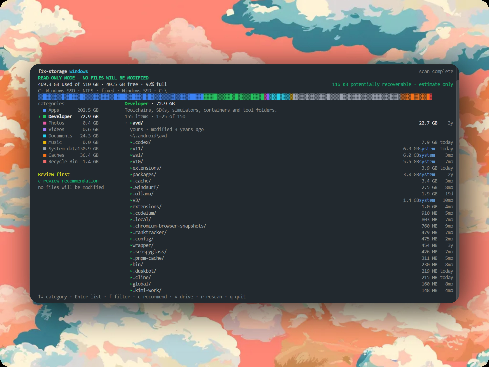

# fix-storage-windows

**READ-ONLY MODE — NO FILES WILL BE MODIFIED.**

`fix-storage-windows` v1 is a native Windows 10/11 storage analysis and cleanup recommendation tool. It measures disk usage, scans directories, classifies storage, identifies large files and caches, estimates potential cleanup opportunities, and presents recommendations. It **never** deletes, recycles, moves, renames, empties, or modifies files.

Cleanup recommendations are informational only. You decide whether to act on them yourself, outside this application.

## Demo



## Product scope

- **Included:** drive discovery, volume information, disk-space reporting, directory scanning, file-size analysis, category classification, large-file identification, temporary and cache identification, possible duplicate candidates, protected-path recognition, permission-error reporting, scan progress, CLI reports, JSON output, plain-text output, terminal UI.
- **Not included:** automated cleanup of any kind. There is no hidden cleanup mode and no activation flag.

## Requirements

- Windows 10 or Windows 11, x64
- Node.js 22 or newer, including npm
- Windows Terminal, PowerShell, PowerShell 7, or Windows Console

The native Recycle Bin bridge from earlier development is archived source only. It is not reached by v1 runtime paths and is not included in the published package.

## Install from source (PowerShell)

```powershell
Set-Location C:\path\to\fix-storage-windows
npm install
npm run build
node bin/fix-storage.cjs --demo
```

To link the `fix-storage` command into npm's user-level global directory:

```powershell
npm install --global .
fix-storage --help
```

No administrator PowerShell is required or recommended.

## Usage

```powershell
fix-storage                    # interactive read-only analysis
fix-storage --demo             # synthetic data; reads and changes nothing
fix-storage --plain            # text storage report
fix-storage --json             # JSON storage report
fix-storage --drives           # volumes, capacities and unassigned volumes
fix-storage --drives --json    # machine-readable volume report
fix-storage --drive C:\        # select by drive path
fix-storage --drive 2          # select the second reported drive
fix-storage --plain --drive "D:\Games"
```

Cleanup-related options such as `--clean`, `--delete`, `--recycle`, `--apply`, `--execute`, and `--dry-run` are rejected with an explanation. They are never passed to any native backend.

Drive selectors accept a one-based number, displayed name, volume label, mount point, volume GUID, or an absolute path on the volume.

### Interactive keys

| Key | Action |
| --- | --- |
| Up/Down or `j`/`k` | Move through categories or items |
| Right/Enter | Enter the item pane or open a folder |
| Left/Escape | Go back |
| Tab | Switch panes |
| PageUp/PageDown | Move ten rows |
| `g` | Jump to the dominant storage culprit |
| `f` | Show only junk/unused, or show everything |
| `c` | Show an informational recommendation |
| `o`/Space | Open a folder or reveal a file in Explorer |
| `v`/`V` | Next/previous drive |
| `1`–`9` | Select a drive |
| `r` | Refresh analysis |
| `q`/Ctrl+C | Quit |

No key triggers filesystem modification.

## Reports and accounting

Category values are estimates based on logical file sizes, not allocated-cluster totals. Independent category estimates can overlap and exceed filesystem usage, so they must not be added together as unique storage. Unmeasured and unreadable space is assigned to System data.

Reports use read-only terminology:

- potentially recoverable space
- measured storage to review
- estimated category size
- recommended review
- storage currently occupied

No report displays actual freed space or a successful cleanup count.

Windows access timestamps are not treated as last-opened dates. The interface displays modification time and never recommends deletion solely because a file has an old timestamp.

## Documentation

- [WINDOWS.md](WINDOWS.md): installation, behavior, limitations, troubleshooting, and validation requirements
- [Architecture](docs/windows-architecture.md)
- [Cleanup security](docs/windows-security.md)
- [Storage categories](docs/windows-storage-categories.md)
- [Compatibility audit](docs/windows-compatibility.md)
- [Progress and implementation status](docs/windows-progress.md)
- [Changelog](CHANGELOG.md)

## License

MIT, matching the original project. The original `fix-storage` repository is unchanged; this directory contains the independent Windows port.
